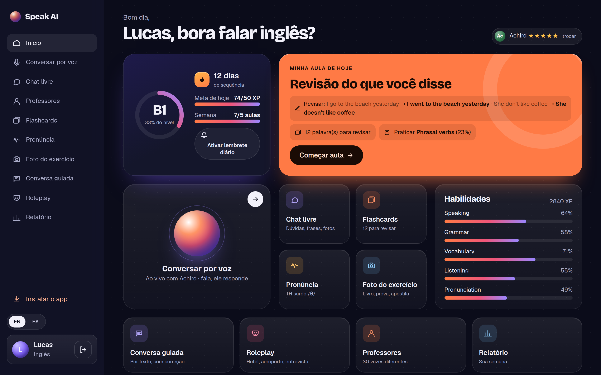
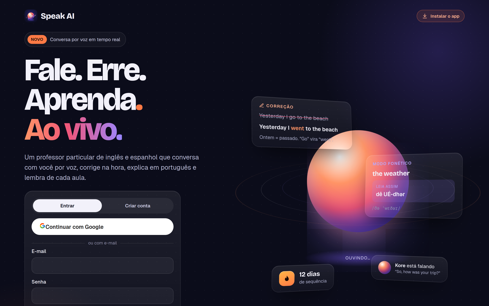
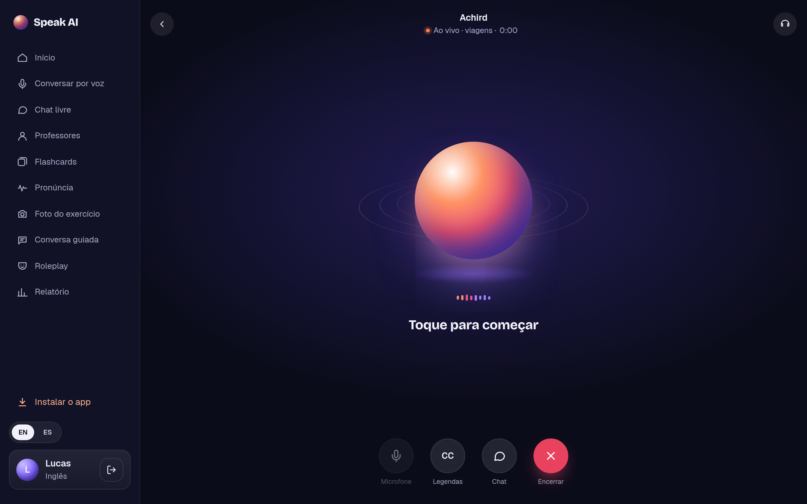
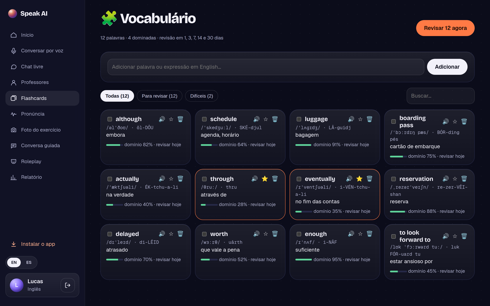
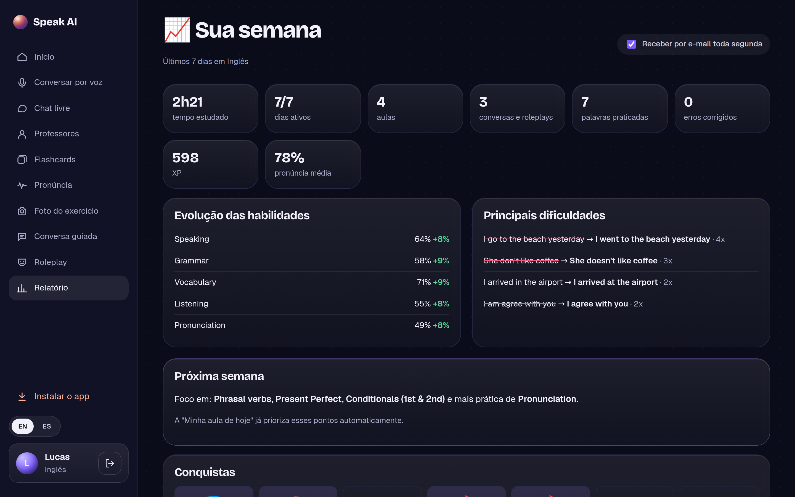
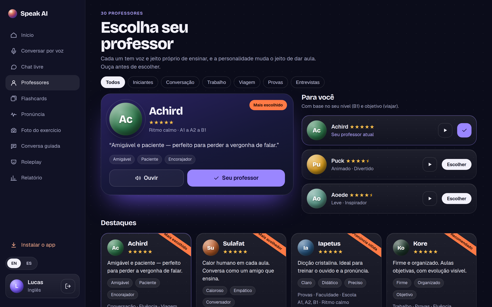
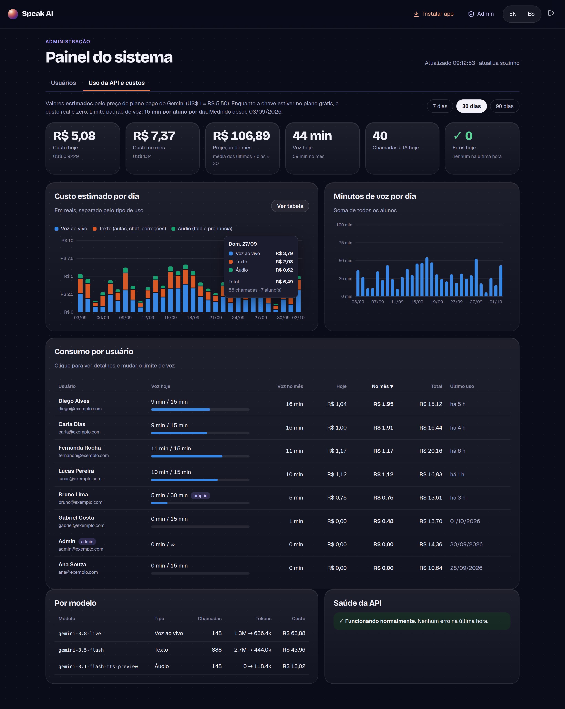
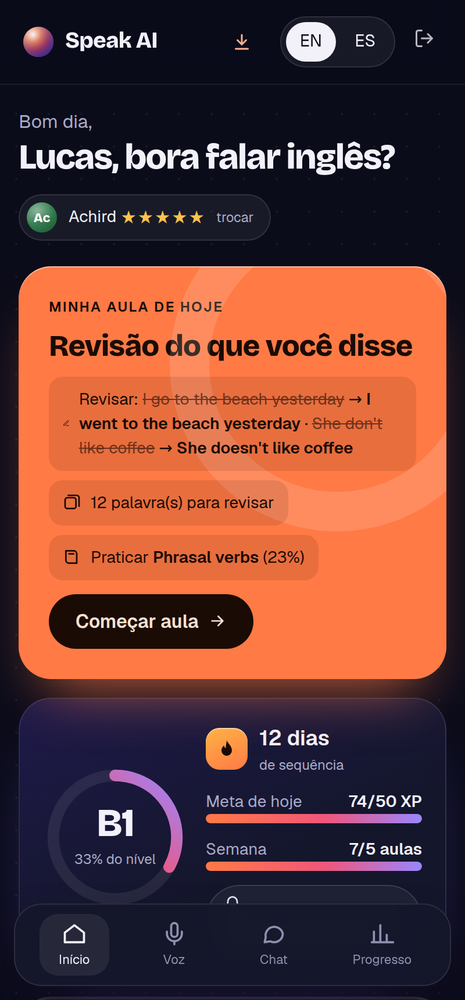
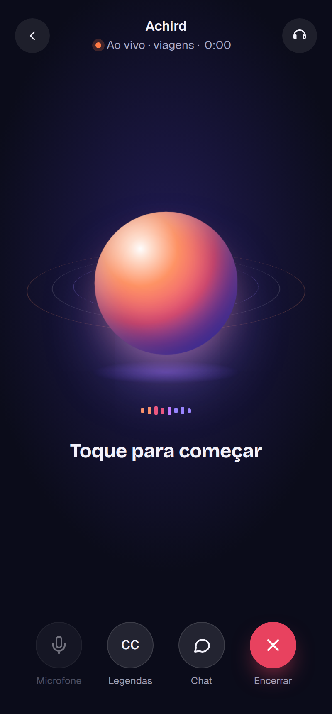

# Speak AI — Professor Particular de Idiomas com IA

[](https://github.com/Mhsilva-dev/speak-ai-showcase/actions/workflows/ci.yml)

Plataforma de aulas de **inglês e espanhol** para brasileiros: o aluno conversa **por voz, em tempo real**, com um professor de IA que corrige na hora, explica em português e lembra do que foi visto nas aulas anteriores. Também tem aulas guiadas, flashcards com repetição espaçada, treino de pronúncia, roleplay, leitura de foto do exercício e relatório semanal. Funciona no computador e instala no celular como aplicativo (PWA).

**🔗 Sistema em produção:** [speak.mhsilvadev.com.br](https://speak.mhsilvadev.com.br)

> O sistema está no ar e aberto para cadastro (com e-mail ou conta Google). Cada aluno tem 15 minutos de conversa por voz por dia; o restante é livre.


<p align="center">
  
</p>

## Telas

| Página inicial | Conversa por voz ao vivo |
|---|---|
|  |  |

| Flashcards (repetição espaçada) | Relatório da semana |
|---|---|
|  |  |

| 30 professores | Painel de custos da API (admin) |
|---|---|
|  |  |

<p align="center">
  
  &nbsp;&nbsp;
  
</p>

> Os dados que aparecem nas imagens são fictícios.

## Funcionalidades

**Conversa por voz em tempo real**
- O aluno fala e o professor responde na hora, como numa ligação, e pode ser interrompido a qualquer momento
- Correções aparecem em cartões na tela enquanto o professor fala (frase errada → certa, com explicação em português)
- Cartão de pronúncia com "modo fonético": como um brasileiro leria a frase, com a sílaba tônica destacada
- Legendas, tradução da fala do professor e chat durante a ligação
- Conversa livre por tema ou **roleplay** (hotel, aeroporto, entrevista de emprego, restaurante…)

**Aulas que se adaptam**
- Teste de nivelamento adaptativo (sobe ou desce de nível conforme as respostas)
- "Minha aula de hoje" montada a partir dos erros recentes do próprio aluno, inclusive os cometidos na conversa por voz
- Aula guiada com tentativa, dica, reforço e redução de dificuldade antes de revelar a resposta
- O professor lembra de fatos e conversas anteriores ("da última vez você me contou que…")

**Prática**
- Flashcards com repetição espaçada (1 → 3 → 7 → 14 → 30 dias)
- Pronúncia: grava a voz do aluno e a IA aponta os sons que precisam melhorar; ditado (listening)
- Foto ou PDF do exercício: o professor lê e resolve junto, sem entregar a resposta
- Chat livre com o professor, com envio de imagens

**Motivação e acompanhamento**
- XP, sequência de dias, metas diária e semanal e 17 conquistas
- Relatório semanal na tela e **por e-mail** toda segunda
- **Lembrete diário por notificação push** para quem ainda não estudou no dia

**Conta e administração**
- Cadastro com e-mail ou **login com Google**, "esqueci a senha" por e-mail
- 30 professores com voz e personalidade próprias
- Painel administrativo: usuários online, quem está em aula por voz, bloqueio, troca de senha
- **Painel de custos da API**: custo estimado por dia e por usuário, minutos de voz, consumo por modelo e erros de cota, com limite de voz configurável por aluno

## Destaques técnicos

- **Voz em tempo real com a Gemini Live API.** O navegador captura o microfone com um `AudioWorklet` (PCM 16 kHz) e manda pelo WebSocket para o servidor, que faz a ponte com o Gemini. A chave da API nunca vai para o navegador. As correções chegam por *function calling* não bloqueante, então o cartão aparece sem interromper a fala. Detalhes em [docs/voz-ao-vivo.md](docs/voz-ao-vivo.md).
- **A IA não decide o fluxo da aula.** Uma máquina de estados no backend controla tentativas, dicas, reforço e troca de dificuldade; a IA só gera conteúdo e avalia respostas, sempre em JSON validado por schema (**zod**). Respostas fora do contrato são reparadas ou refeitas.
- **Fallback entre modelos.** Se um modelo falha, fica sem cota ou demora, o próximo da lista é usado; modelos sem cota ficam "de castigo" pelo tempo que a própria API informa.
- **Pedagogia mensurável.** Domínio de 0 a 100 por habilidade, áreas (fala, gramática, vocabulário, compreensão, pronúncia), erros recorrentes com revisão espaçada e foco do dia calculado a partir das fraquezas. Ver [docs/pedagogia.md](docs/pedagogia.md).
- **Custo sob controle.** Cada chamada à IA registra tokens por tipo (texto/áudio, entrada/saída) e o custo estimado; a conversa por voz é medida por sessão e o limite diário é aplicado no servidor, inclusive encerrando a ligação quando o tempo acaba.
- **Segurança.** Senhas com bcrypt e comparação em tempo constante, sessão JWT em cookie `httpOnly`/`sameSite` com versão (trocar a senha derruba as outras sessões), OAuth do Google com `state`, token de redefinição guardado só como hash e com uso único, limite de requisições por usuário/IP, verificação da assinatura real dos arquivos enviados, validação do endpoint de push (evita SSRF), WebSocket só da mesma origem, CSP e servidor escutando só em `127.0.0.1` atrás do Nginx.
- **Testes de ponta a ponta.** 111 testes com `node:test` + **supertest** contra um PostgreSQL de teste, com a IA simulada por um provedor *mock* — rodam no CI a cada push.
- **Sem framework no front-end.** SPA em JavaScript puro com módulos ES, roteamento por History API, service worker e manifest para instalação como PWA.

## Arquitetura

```
Navegador / PWA ──► Nginx (SSL) ──► Node.js / Express ──► PostgreSQL
      ▲                                   │
      └──── WebSocket (áudio PCM) ────────┤
                                          ├── Gemini Live API (voz em tempo real, WebSocket)
                                          ├── Gemini (aulas, correção, pronúncia, fotos, TTS)
                                          ├── Google OAuth (login)
                                          ├── Gmail SMTP (senha e relatório semanal)
                                          └── Web Push / VAPID (lembrete diário)
```

A documentação técnica, com diagramas em Mermaid, fica em [`docs/`](docs/):

- [Arquitetura](docs/arquitetura.md)
- [Conversa por voz ao vivo](docs/voz-ao-vivo.md)
- [Motor pedagógico](docs/pedagogia.md)
- [Banco de dados (ERD)](docs/banco-de-dados.md)
- [Referência da API](docs/api-referencia.md)

## Estrutura

```
src/
├── server.js                 sobe o servidor e as rotinas em segundo plano
├── app.js                    Express, API e SPA
├── config/                   configuração (.env)
├── db/                       pool do PostgreSQL e migrações SQL versionadas
├── languages/                currículo de inglês e espanhol, cenários e professores
├── middleware/auth.js        sessão, login obrigatório e admin
├── routes/                   rotas da API e webhook de deploy
└── services/
    ├── ai/                   cliente Gemini, prompts, schemas zod e provedor mock
    ├── pedagogy/             máquina de estados, domínio, SRS, nivelamento, conquistas
    ├── audio/                pronúncia e texto-para-fala (com cache)
    ├── live.service.js       ponte WebSocket navegador ⇄ Gemini Live
    ├── lesson / conversation / tutor / vocabulary / material / report …
    ├── usage.service.js      custo por chamada e limite diário de voz
    ├── push / weekly-email / mail / google / auth / admin
public/
├── index.html, app.js        SPA e roteador
├── js/                       núcleo, áudio (AudioWorklet), PWA e uma view por tela
├── sw.js, manifest.json      PWA
test/                         testes de API e de pedagogia (IA simulada)
```

## Como rodar localmente

Requisitos: Node.js 20+ e Docker (para o PostgreSQL).

```bash
git clone https://github.com/Mhsilva-dev/speak-ai-showcase.git
cd speak-ai-showcase

docker compose up -d          # PostgreSQL com os bancos speak e speak_test
npm install
cp .env.example .env          # defina JWT_SECRET e GEMINI_API_KEY
npm start
```

Acesse `http://localhost:3020`. As tabelas são criadas automaticamente na primeira execução. Para tornar uma conta administradora: `UPDATE users SET is_admin = true WHERE email = 'seu@email.com';`

- `npm test` roda os testes com a IA simulada (não precisa de chave do Gemini).
- Opcionais: `GOOGLE_CLIENT_ID/SECRET` (login com Google), `SMTP_*` (e-mails), `VAPID_*` (lembrete push). Sem eles o restante funciona normalmente.

## Deploy

Em produção roda em uma VPS Linux com **PM2** ([`ecosystem.config.js`](ecosystem.config.js)), **Nginx** com SSL do **Let's Encrypt** ([`nginx.conf`](nginx.conf) de referência) e PostgreSQL em Docker. Um push na `main` dispara um webhook do GitHub (assinado com HMAC) que atualiza o código e reinicia o app; um backup diário do banco e dos uploads roda via cron ([`scripts/backup.sh`](scripts/backup.sh)).

## Autor

Desenvolvido por **Matheus Henrique Fonseca Silva** — [GitHub](https://github.com/Mhsilva-dev) · [LinkedIn](https://www.linkedin.com/in/matheus-silva-01b8b3433)
