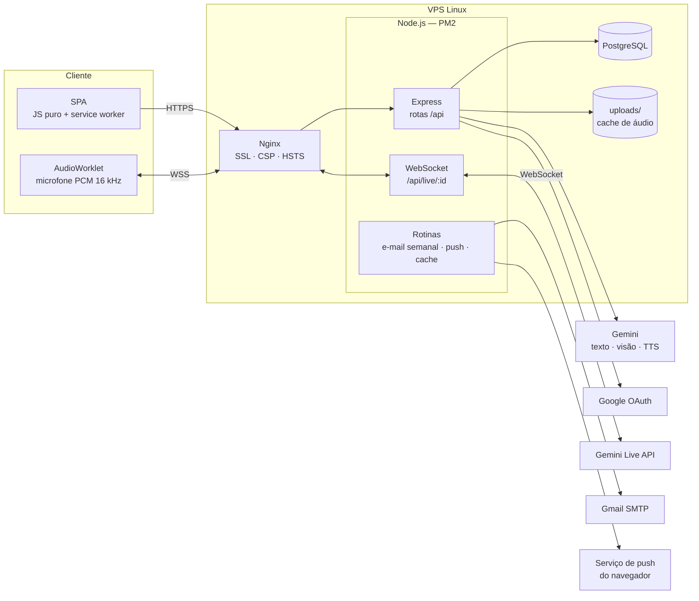
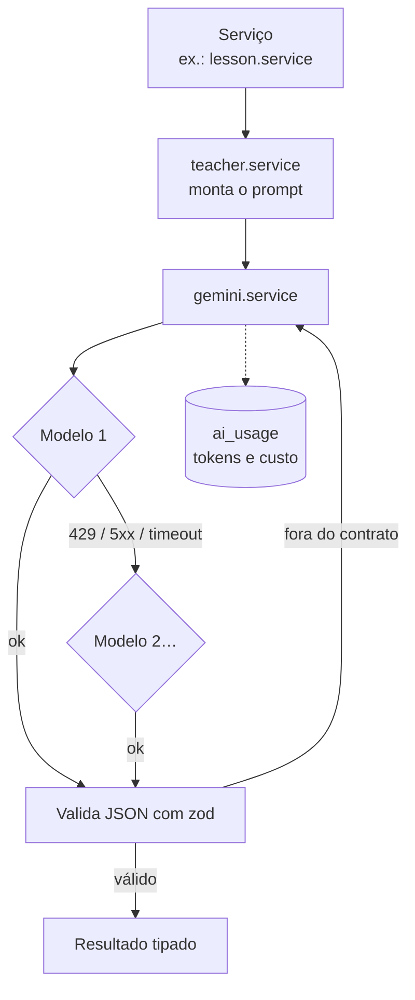

# Arquitetura

O Speak AI é um monólito Node.js: um único processo Express serve a SPA, a API REST e o WebSocket da conversa por voz. Os dados ficam no PostgreSQL. Toda a inteligência vem do Google Gemini, mas **o backend é quem decide o fluxo**: a IA gera conteúdo e avalia respostas dentro de contratos JSON.

## Fluxo de uma requisição

1. O Nginx termina o TLS, aplica os cabeçalhos de segurança e repassa para `127.0.0.1:3020`.
2. `requireAuth` lê o JWT do cookie `httpOnly`, confere a **versão da sessão** no banco (trocar a senha invalida as outras sessões) e guarda o usuário num `AsyncLocalStorage` — assim toda chamada à IA feita durante a requisição é contabilizada para ele.
3. A rota valida o básico e chama um serviço em `src/services`, onde ficam as regras.
4. Erros de negócio são `HttpError(status, mensagem)`; o handler central devolve JSON com a mensagem em português.

## Camada de IA

- **Um único ponto de contato** (`gemini.service.js`): timeout, novas tentativas para erros transitórios e lista de modelos reserva.
- **Cota esgotada**: o modelo fica fora da lista pelo tempo informado pela própria API (`retry in Xs`), e as próximas chamadas vão direto para o seguinte.
- **JSON robusto**: remove cercas de markdown, recorta o objeto e corrige vírgulas sobrando antes de validar com zod.
- **Testes sem IA**: com `NODE_ENV=test` o provedor é um *mock* determinístico, então os 111 testes rodam no CI sem chave e sem custo.

## Tarefas em segundo plano

| Rotina | Quando | O que faz |
|---|---|---|
| Relatório semanal | segunda, a partir das 8h (Brasília) | e-mail com o resumo de quem estudou; controle por semana do calendário |
| Lembrete push | a cada 10 min | avisa quem tem aparelho inscrito, passou do horário escolhido e ainda não estudou no dia |
| Cache de áudio | diário | apaga áudios sem uso há 60 dias e mantém o total abaixo de 1 GB |
| Encerramento | `SIGTERM` | fecha as conversas por voz gravando o tempo usado antes de sair |

## Segurança

- Senhas com **bcrypt**; login compara contra um hash fictício quando o e-mail não existe (tempo constante, não revela quem tem conta).
- Sessão JWT em cookie `httpOnly`, `sameSite=lax`, `secure` em produção, com `session_version`.
- Login com Google por *authorization code* + `state` em cookie; ao ligar o Google a uma conta cujo e-mail nunca foi comprovado, a senha antiga é apagada (evita pré-cadastro com e-mail alheio).
- "Esqueci a senha": token aleatório guardado só como **hash SHA-256**, uso único, 1 hora de validade, no máximo um e-mail a cada 2 minutos.
- Link de descadastro do e-mail assinado com chave derivada própria — nunca vale como sessão.
- Uploads conferem a **assinatura real** do arquivo (magic bytes), não o mimetype enviado.
- Endpoint de push validado contra a lista de serviços conhecidos (evita SSRF).
- WebSocket da voz só aceita a **mesma origem**.
- Rate limit por usuário (ou IP, sem login) em todas as rotas que custam IA.
- Nginx com CSP restritiva, HSTS, `X-Frame-Options`, `nosniff` e `Permissions-Policy` (microfone só no próprio site).

## Migrações

Arquivos SQL numerados em `src/db/migrations/`, aplicados em ordem dentro de transação na subida do servidor e registrados em `schema_migrations`.
