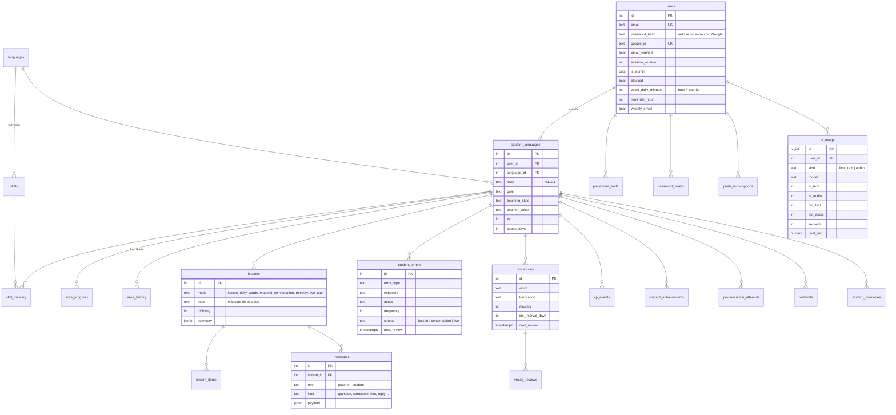

# Banco de dados

PostgreSQL. O progresso é sempre **por idioma**: um aluno que estuda inglês e espanhol tem dois `student_languages`, cada um com seus níveis, erros, vocabulário e conquistas.

## Notas

- `skills` é preenchida a partir de `src/languages/*.js` toda vez que o servidor sobe (novas habilidades entram sozinhas); adicionar um idioma é criar o arquivo de conteúdo e registrá-lo.
- `student_errors` tem chave única em `(student_language_id, error_type, expected, actual)`: repetir o mesmo erro aumenta a frequência em vez de duplicar.
- `password_resets` guarda só o hash do token.
- `ai_usage` mantém o histórico mesmo se o usuário for excluído (`ON DELETE SET NULL`), para o custo total continuar correto.
