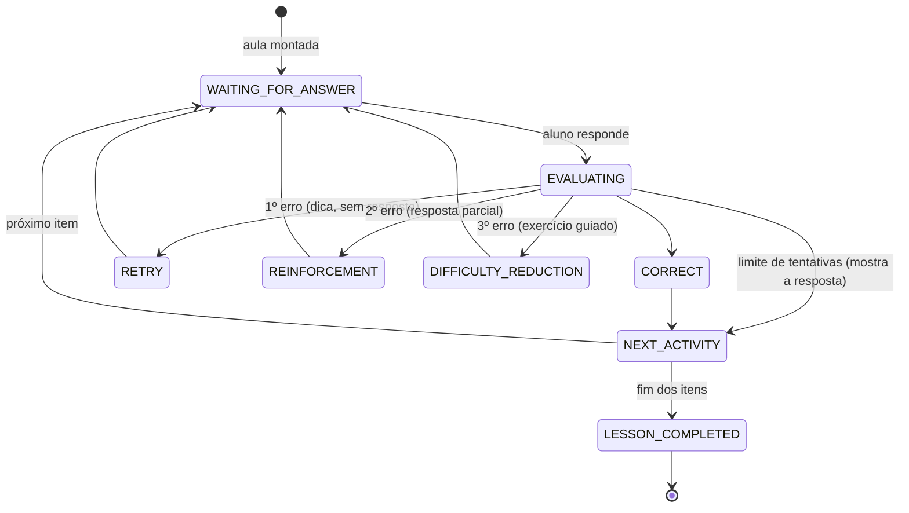

# Motor pedagógico

O princípio é simples: **a IA ensina, o backend decide**. A IA gera exercícios, avalia respostas e escreve explicações; a progressão do aluno (o que praticar, quando revelar a resposta, quando subir a dificuldade) é calculada por código determinístico e testado.

## Máquina de estados da aula

- O número de tentativas e o momento de revelar a resposta dependem do estilo do professor escolhido (amigável, equilibrado ou rígido).
- Acertos seguidos aumentam a dificuldade dos próximos itens; erros a reduzem.
- Fugir do tema não conta como tentativa: o professor redireciona.

## Domínio por habilidade

- Cada habilidade do currículo (ex.: *Past Simple*, *Present Perfect*, *TH surdo /θ/*) tem um domínio de 0 a 100.
- Acertar de primeira soma mais (proporcional à dificuldade); acertar depois de errar soma pouco; errar subtrai.
- Faixas: iniciante (até 30), em desenvolvimento (até 60), bom (até 80), dominado (81+).
- As cinco áreas (fala, gramática, vocabulário, compreensão, pronúncia) são atualizadas a cada atividade e ganham uma foto diária para o relatório semanal.

## Erros recorrentes e revisão espaçada

- Cada erro é registrado com a forma errada e a correta (`I go yesterday` → `I went yesterday`), a frequência e a origem (aula escrita, conversa por texto ou por voz).
- Erros e flashcards seguem a mesma revisão espaçada: **1 → 3 → 7 → 14 → 30 dias**; errar volta para 1 dia.
- A **"Minha aula de hoje"** prioriza os erros das conversas dos últimos dias, os flashcards vencidos e a habilidade mais fraca do nível.

## Nivelamento adaptativo

- Começa no A2. Nota ≥ 70 sobe um nível; nota abaixo de 40 desce.
- Seis perguntas geradas e corrigidas pela IA; o nível final e a confiança são calculados pelo backend.

## Gamificação

- XP por atividade (acerto de primeira vale mais que acerto depois de dica), sequência de dias no fuso de Brasília, metas diária e semanal.
- 17 conquistas (primeira aula, 7 dias seguidos, 100 revisões, pronúncia acima de 90%, aula perfeita…).
