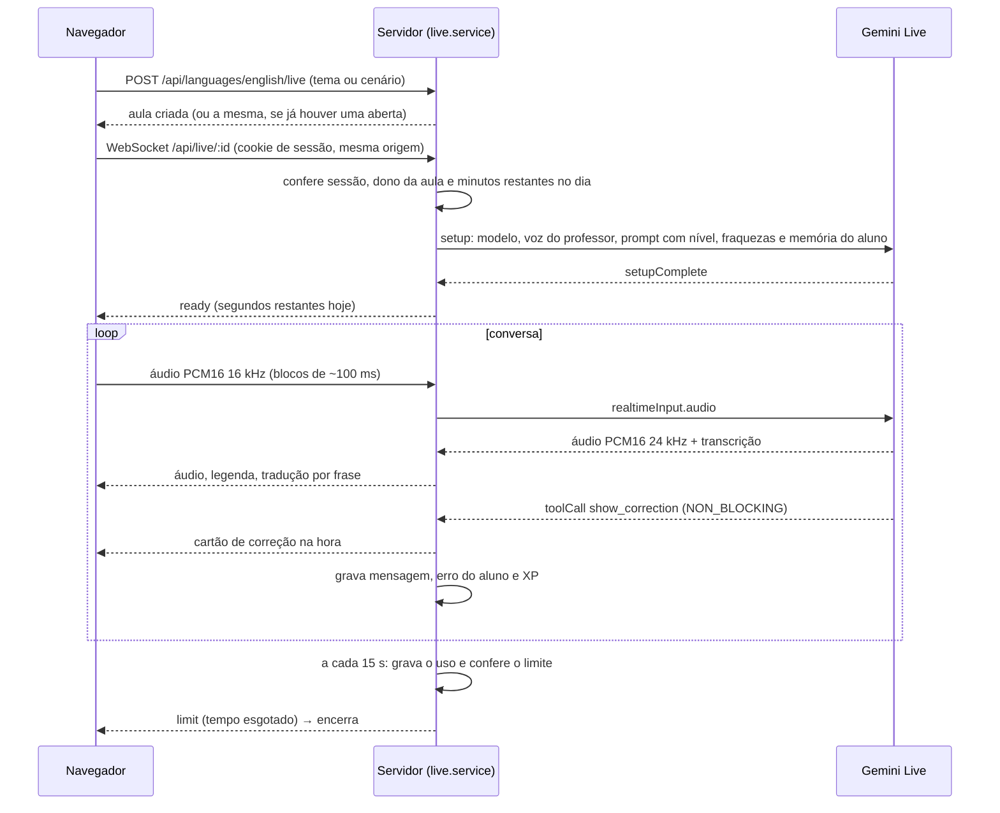

# Conversa por voz ao vivo

A conversa por voz é uma ligação em tempo real com o professor. O servidor faz a ponte entre o navegador e a **Gemini Live API**, o que mantém a chave da API no servidor e permite gravar a conversa, aplicar correções e medir o tempo de uso.

## No navegador

- `mic-worklet.js` (**AudioWorklet**) captura o microfone, reamostra para 16 kHz e entrega blocos PCM16; `live-audio.js` toca o áudio do professor (24 kHz) numa fila contínua, sem cortes entre blocos.
- Sem fone, o microfone espera o professor terminar (evita que ele ouça a si mesmo); com fone, o aluno pode interromper à vontade.
- Se a conexão cai, o cliente reconecta e o professor retoma de onde parou (as últimas falas voltam no prompt).

## No servidor

- **Uma conversa por pessoa**: abrir em outra aba ou aparelho encerra a anterior com aviso, em vez de as duas disputarem o microfone.
- **Correções sem pausa**: as funções `show_correction` e `show_phrase` são declaradas como `NON_BLOCKING` e respondidas com `scheduling: SILENT`, então o cartão aparece enquanto o professor continua falando.
- **Tradução por frase**: assim que uma frase do professor termina, ela é traduzida em paralelo por um modelo rápido.
- **Memória**: fatos e resumos de conversas anteriores entram no prompt; os erros cometidos na voz alimentam a "aula do dia" seguinte.
- **Modelos reserva**: se o modelo principal não conecta, o próximo da lista é tentado.

## Limite e custo

- Cada sessão vira uma linha em `ai_usage`, atualizada a cada 15 segundos com a duração e os tokens de áudio informados pelo Gemini (ou uma estimativa pelo tempo, se a contagem não vier).
- O limite diário (padrão 15 min, configurável por aluno no painel de admin; admin sem limite) é conferido ao criar a aula, ao abrir o WebSocket e durante a ligação.
- Ao reiniciar o servidor, as sessões abertas são encerradas gravando o tempo usado.
